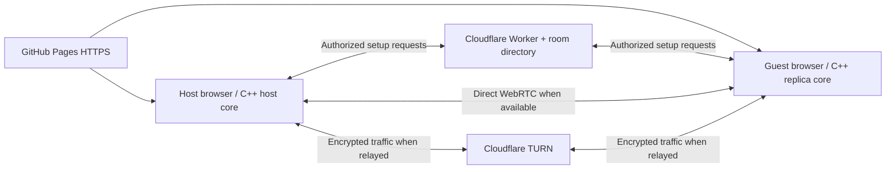

# Internet connectivity and deployment boundaries

The deployed path is **GitHub Pages → browser game**, with **Cloudflare private signaling and temporary TURN issuance** for connection setup. Gameplay is WebRTC between a host and one guest, direct or relayed. This document explains the network responsibilities; exact implementation contracts are in [browser connection](../specs/browser-connection.md), [private lobbies](../specs/private-lobbies.md) and [TURN service](../specs/turn-service.md).

## Connection and gameplay paths

Each page load creates an independent engine/core instance. Static hosting alone does not connect them. The protected directory exchanges SDP/ICE and deletes its record once both peers connect; it carries no simulation loop. TURN forwards traffic when ICE selects a relay route; it does not become an authoritative game server. The host remains trusted for gameplay.

GitHub Pages serves the single-thread Godot export without custom cross-origin-isolation headers. A custom domain is optional and changing the page URL does not solve NAT reachability. Deployment details are in [assets and hosting](../specs/assets-hosting.md).

## Routers, NAT and firewalls

The normal browser flow does not ask players to forward ports. ICE tests candidate pairs, using STUN to obtain mapped-address candidates and configured TURN for relay candidates. A candidate list alone is not proof of connectivity.

| Situation | Consequence |
| --- | --- |
| Same computer or LAN | Direct paths may work; Wi-Fi isolation, host firewalls and browser policy can still interfere. |
| Different home routers, double NAT or CGNAT | Direct success depends on both endpoints' mappings/filtering. TURN provides another reachable path; a NAT label alone does not establish success or failure. |
| UDP blocked or restrictive network | TURN TCP/TLS can provide additional client-to-relay routes. TLS on port 443 is not ordinary HTTPS and can still be blocked. This network condition has not been tested here. |
| Sleep, VPN switch or network change | An existing connection may break. The current prototype requires a fresh session; automatic ICE restart/reconnect is absent. |

Default **Direct + relay fallback** permits both paths. **Relay only (test)** requests only relay candidates and enables the test HUD. Tests inspect the actually selected candidate pair; the dropdown alone is not evidence of routing. The latest successful test is forced relay, not direct-path or automatic-fallback acceptance.

The native ENet lab uses direct UDP without ICE/STUN/TURN. Across networks it needs UDP reachability such as LAN, a suitable VPN or forwarding. Browser TURN does not relay ENet; native-to-browser play requires a compatible transport adapter and is not implemented.

## Certificates and credentials

| Boundary | Current responsibility |
| --- | --- |
| Game download | GitHub supplies HTTPS for the github.io site. Players install no certificate. |
| Room/credential HTTP | Managed Cloudflare HTTPS; requests require the playtest key and allowed Origin. CORS alone is not authentication. |
| WebRTC data channels | Peers exchange DTLS fingerprints through signaling. Players do not buy per-PC certificates. Signaling authorization still matters. |
| TURN TLS | Managed relay service owns its endpoint certificates. Self-hosting would require a trusted hostname/certificate and renewal. |

The browser receives temporary TURN credentials, never the account token or TURN issuer secret. The shared playtest key grants access to the room directory and relay issuance; it is neither individual identity nor Cloudflare administration. It must be shared privately. The prototype has request limits but no global spending cap or per-tester bans.

A future self-hosted coturn alternative would need public address mapping, UDP/TCP listeners, TLS and an explicit relay allocation port range through its firewall. An ordinary HTTP reverse proxy does not provide TURN UDP forwarding. These are replacement-service requirements, not setup steps for today's managed deployment.

## Traffic and acceptance

The core emits guest inputs of 24 bytes × 60/s and host snapshots of 104 bytes × 20/s: **3,520 bytes/s**, about **12.7 MB/hour of application payload** per pair. This excludes ping, Godot RPC, SCTP/DTLS/IP, retransmission and TURN overhead. Provider transfer accounting and real concurrency must be measured before estimating cost. This game sends simulation messages, not video.

Workstation↔Runpod Chrome automatic-lobby gameplay has passed with relay/relay candidates, replicated movement/combat and independent cores. This establishes one tested route, not a general internet-reliability guarantee. Firefox, direct routes/fallback, blocked UDP/TCP-only, session interruption and credential-lifecycle tests remain in [the backlog](../BACKLOG.md). [Verification](../specs/verification.md) owns the evidence and limits.

## Protocol references

These explain the established protocol/deployment model; they are not evidence that this prototype passed every network condition:

- [GitHub Pages](https://docs.github.com/en/pages/getting-started-with-github-pages/what-is-github-pages) and [Godot Web export](https://docs.godotengine.org/en/stable/tutorials/export/exporting_for_web.html).
- [ICE](https://www.rfc-editor.org/rfc/rfc8445.html), [TURN](https://www.rfc-editor.org/rfc/rfc8656.html), [WebRTC security architecture](https://www.rfc-editor.org/rfc/rfc8827.html) and [data channels](https://www.rfc-editor.org/rfc/rfc8831.html).
- [Godot WebRTC](https://docs.godotengine.org/en/stable/tutorials/networking/webrtc.html) and [coturn configuration](https://github.com/coturn/coturn/blob/master/examples/etc/turnserver.conf).
