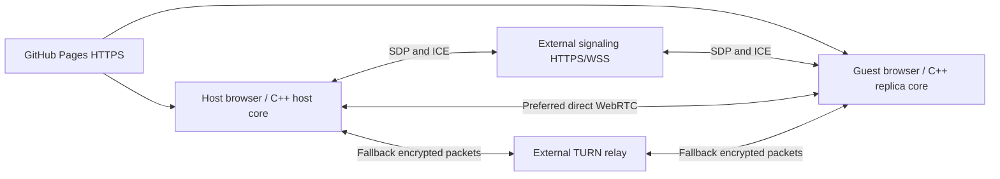

# Internet co-op: conventional deployment study

Reviewed 2026-10-19. Recommendation: keep GitHub Pages for the static game, add a small authenticated signaling service and a standards-compatible TURN fallback when internet connectivity becomes a deliverable. Prefer direct WebRTC when it works; relay the same encrypted gameplay stream when it does not. Neither service changes the portable simulation/C ABI. The initial study deployed no services. Subsequent owner authorization added the protected Cloudflare TURN issuer described in [the current service spec](../specs/turn-service.md); subsequent authorization also added [private lobby signaling](../specs/private-lobbies.md).

## What a new GitHub page does

Both players load the exported Godot game and portable Wasm core from HTTPS GitHub Pages. A second tab or another PC creates a separate engine/core instance, but hosting the files does not connect the players. Pages is static hosting; signaling and relay must run elsewhere. A custom domain is optional. The existing single-thread export avoids the cross-origin-isolation headers required by threaded Godot exports; relocating a page does not cure NAT problems. [GitHub Pages](https://docs.github.com/en/pages/getting-started-with-github-pages/what-is-github-pages), [GitHub HTTPS](https://docs.github.com/en/pages/getting-started-with-github-pages/securing-your-github-pages-site-with-https), [Godot Web export](https://docs.godotengine.org/en/stable/tutorials/export/exporting_for_web.html).

The conventional flow is:

1. Host creates a private room; guest joins using an invitation.
2. Signaling exchanges SDP offers/answers and ICE candidates. The private lobby now exchanges these automatically over HTTPS; manual codes remain an advanced fallback. It carries connection metadata rather than the 60 Hz game loop.
3. Browser ICE tests address pairs. STUN discovers mapped addresses. A successful direct path carries game inputs/snapshots peer to peer.
4. With configured TURN, ICE can select a relay path if direct candidates do not work. The host still owns simulation; the relay forwards encrypted packets. This is a transport fallback, not a dedicated authoritative game server. [WebRTC peer connections](https://webrtc.org/getting-started/peer-connections), [TURN guidance](https://webrtc.org/getting-started/turn-server), [ICE standard](https://www.rfc-editor.org/rfc/rfc8445.html).

## NAT, routers and firewalls

| Environment | Expected approach and limit |
| --- | --- |
| Same PC / home LAN | Direct candidates often work. Guest Wi-Fi isolation, browser policy or host firewalls can still prevent them. Same-machine success does not prove internet connectivity. |
| Different home routers | ICE/STUN attempts direct traversal automatically; do not require players to forward ports as the normal browser flow. |
| CGNAT / double NAT / endpoint-dependent mappings | Direct success depends on both endpoints' mappings/filtering; TURN provides an independently reachable relay. CGNAT alone does not prove a direct path is impossible. |
| UDP blocked / restrictive office network | Offer TURN over TCP and TLS as additional client-to-relay transports; TLS on port 443 improves reachability but is not HTTPS and may still be blocked by inspection/proxy policy. |
| Network changes / sleep / VPN switch | A previously working connection can fail. ICE restart/re-signaling or a fresh session is needed; a startup-only signaling design is insufficient for seamless recovery. |

These are operational expectations, not success-rate guarantees. ICE explicitly tests connectivity; do not infer a usable route from an IP address or a NAT label. [ICE](https://www.rfc-editor.org/rfc/rfc8445.html), [TURN](https://www.rfc-editor.org/rfc/rfc8656.html).

The current **native ENet lab is different**: it uses direct UDP, without browser ICE/STUN/TURN. Across the internet it needs host UDP reachability, firewall permission, often port forwarding, or a suitable VPN/native relay solution. Opening UDP 27840 on a router does not implement a WebRTC relay. A browser cannot connect to an arbitrary ENet UDP socket. Native-to-browser play would need a compatible WebRTC native transport adapter; it is not currently provided. [Godot WebRTC](https://docs.godotengine.org/en/stable/tutorials/networking/webrtc.html).

## Certificates and ports

| Connection | Certificate / deployment work |
| --- | --- |
| Game download | GitHub provides HTTPS for github.io. No player installation. For a custom domain, configure DNS and GitHub HTTPS correctly. |
| Signaling / credential endpoint | Use HTTPS/WSS with a browser-trusted certificate, DNS and renewal. Managed providers handle their endpoints; self-hosting needs operations. An HTTPS page must not depend on insecure ws:// signaling. |
| Peer data channel | Browser WebRTC uses DTLS and exchanges certificate fingerprints through SDP. Players do not buy certificates or install a custom CA for each PC. Signaling identity/invitation security still matters. |
| TURN over TLS (turns:) | Relay needs a hostname and certificate trusted by clients, with renewal. A self-signed development certificate is not a normal player setup. STUN/ordinary TURN over UDP do not use that TLS certificate. |

DTLS encryption remains between the browser peers when TURN forwards their data; TURN does not become the gameplay authority. It can observe traffic metadata. Share manual codes privately: they contain connection details, and the current random session identifier prevents stale-answer mixups rather than authenticating a person. [WebRTC security architecture](https://www.rfc-editor.org/rfc/rfc8827.html), [data-channel stack](https://www.rfc-editor.org/rfc/rfc8831.html).

For a self-hosted coturn deployment, conventional defaults include 3478 UDP/TCP, 5349 TLS, and an explicitly configured UDP relay allocation range through the server firewall. Consider a dedicated listener/IP for TLS 443: it cannot simply share the same socket with an ordinary HTTPS web server, and a normal HTTP reverse proxy does not proxy TURN UDP. Configure public/external address mapping if the relay itself is behind NAT. Confirm the exact chosen provider/container networking and port range rather than blindly opening all ports. [coturn configuration](https://github.com/coturn/coturn/blob/master/examples/etc/turnserver.conf), [coturn server guide](https://github.com/coturn/coturn/wiki/turnserver).

## Service choices and cost shape

| Choice | Role and tradeoff |
| --- | --- |
| Firebase | Realtime Database can exchange room signaling records. Auth, room authorization, expiration/cleanup and quotas still need implementation. It is not TURN. [Database setup](https://firebase.google.com/docs/database/web/start). |
| Supabase | Realtime private broadcast can exchange signaling, with authenticated room access. It is not TURN. [Broadcast](https://supabase.com/docs/guides/realtime/broadcast). |
| Managed TURN + small managed signaling | Reduces relay operations; compare regions, transfer accounting, TCP/TLS support, temporary credentials and quota behavior before choosing a vendor. |
| Small public VPS | Can run WSS signaling and coturn as separate services. More control, but certificate renewal, firewall rules, security updates, credential minting, monitoring and bandwidth are ours. |

Recommendation is architectural, not a vendor purchase recommendation: start with a reachable TURN service plus minimal private signaling when moving beyond a manual experiment. One VPS can host both at prototype scale if it has suitable public networking and a bandwidth allowance; a managed relay is also conventional. Firebase/Supabase only solve the signaling part unless combined with another relay service. Provider limits/prices must be rechecked when selecting/deploying; no zero-cost or guaranteed free-tier claim is made.

TURN credentials must be short-lived and minted by a trusted endpoint. Never commit the coturn shared secret, provider master token or long-lived relay password into public source, Pages JSON or the Wasm binary. Enforce allocation/session limits, peer restrictions, bandwidth budgets and credential expiry. The current Cloudflare implementation and its prototype protection/limits are recorded in [the service spec](../specs/turn-service.md). [coturn authentication options](https://github.com/coturn/coturn/wiki/turnserver).

Current payloads are small: guest inputs 24 bytes × 60/s plus host snapshots 104 bytes × 20/s = **3,520 bytes/s**, about **12.7 MB/hour of application payload** per pair, before ping, Godot RPC, SCTP/DTLS/IP, retransmissions and TURN overhead. Relay receives and forwards traffic, and providers account for transfer differently. Measure real traffic and simultaneous pairs before estimating a bill; no video streaming is involved. This calculation follows the project's [C ABI](../specs/c-abi.md).

## Implemented now and deferred acceptance gates

Easy local changes: validate bounded, versioned manual codes and ICE fields; correlate answers to the current offer; clear old codes when resetting; handle WebRTC setup errors; surface ICE failure, empty gathering and timeouts with a direct-only/relay-needed explanation. These do not bypass NAT or make TURN available. The manual envelope has version 1 and gameplay protocol 1; older unversioned prototype codes must be regenerated on both ends.

Harder work remains in [BACKLOG.md](../BACKLOG.md): authenticated/expiring signaling rooms; broader relay acceptance and credential refresh; supported Godot/browser configuration for relay-only testing; reconnection/ICE restart; route diagnostics; browser-to-browser and separate-network testing. Only a non-empty candidate list is not proof of a connection.

Before calling internet co-op supported, verify actual replicated movement/combat on two PCs on separate networks, direct and deliberately forced-relay paths, expired credentials, blocked UDP with TCP/TLS fallback, stale/wrong invites, reload/rejoin, host exit and interrupted connectivity. Use browser WebRTC selected-candidate-pair statistics to establish whether the route is host/server-reflexive/relay and measure RTT/loss. The test harness captures browser candidate-pair statistics without publishing IPs/SDP; the menu requests relay-only through WebRTC configuration. Verify both in each tested browser. A non-loopback/native test and a hosted single-player smoke test do not satisfy this gate. The subsequent Cloudflare deployment is documented separately in the service spec.
